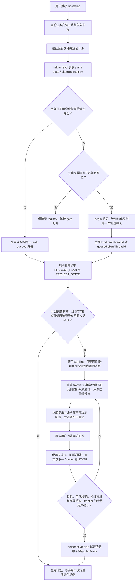
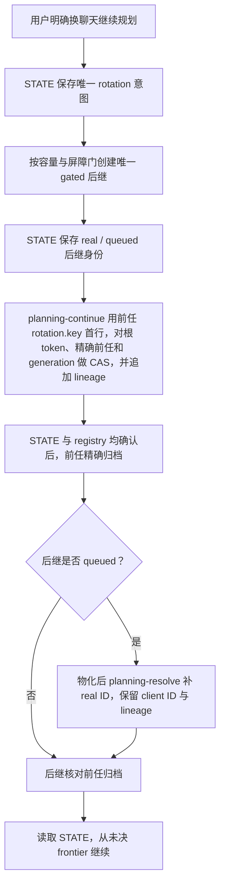
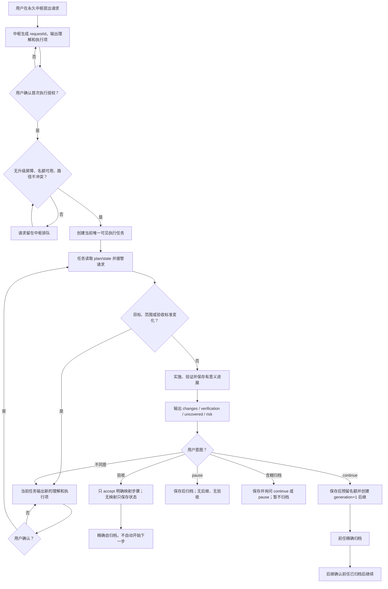
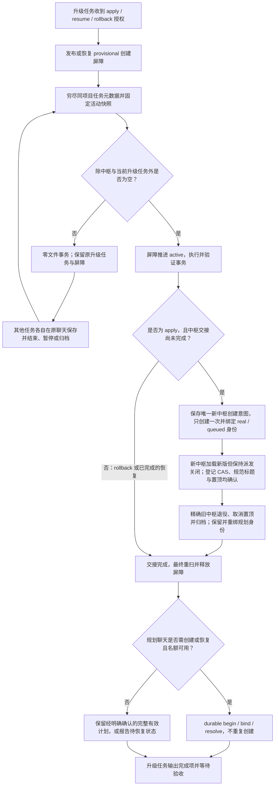

# 工作流交互模式

本文档是 Codex Project Flow 0.14.0 / schema 13 的共享交互设计。机器字段以 `.agents/workflow.json` 为准，角色步骤以 `.agents/WORKFLOW_PROTOCOL.md` 为准。创建可见聊天采用 Codex 默认模型设置；隐藏子代理采用平台默认继承，不附带模型或推理强度覆盖。

## 初始化与规划

规划聊天允许从不完整想法开始，不要求用户预先给出最终结果。同一轮覆盖全部当前可决定问题，每题附建议；依赖未解决的问题留给后续 frontier。事实助手可并行查询，不阻塞同轮其他可决定问题。每轮保存未决树与下一 frontier，继任从未决处继续。确认绑定的是完整规划理解，不是每份 Markdown 的草稿；未知步骤保持未勾选。只有完整有效且有明确人类确认依据的计划才跳过 grilling；格式合法不等于已确认，已有内容有用但缺项或缺确认时只补问必要内容，不从头重做。

## 规划聊天续接

`rotation-request` 必须是 helper 按 registry project/current hub/root token/predecessor/下一 generation 严格计算的前任机器 `rotation.key` 精确首行，不是用户描述；lineage 同时保存该代的 `hubThreadId`。hub rebind 后，旧交接按已存 old-hub key 幂等恢复，新交接使用 current hub。任一步失败或结果未知都保留同一次交接并恢复，不重复创建。Bootstrap/Upgrade 读取规划 registry 的当前 generation 与 lineage，不能把已续接前任当作当前规划聊天恢复。

## 请求执行与归档

同一请求任何时刻只有一个可执行的当前代。continue 后继继承同一 `requestId`、当前计划步骤和既有边界，generation 加一；它重读工作区，历史验证只算历史证据。名额不足时等待，不能突破五个占位身份。

## 升级协调

升级不能强制归档活动执行任务，也不从归档推断验收。apply 在文件验证后自动交接到新中枢，旧中枢只在新登记、规范标题和置顶均确认后精确归档；创建未知、queued 或交接失败保持同一意图和屏障，不重复创建。plan 和 rollback 不更新中枢。事务保留项目事实、计划和状态，规划聊天保留原身份与续接链。屏障释放后可确保规划聊天，但不会自动启动下一项目步骤。

## 角色边界

- 永久中枢：只做新请求初始理解、首次授权、排队和可见任务创建；不长谈项目计划，不接管已移交请求。
- 规划聊天：自动用 `$grilling` 的依赖决策树讨论背景、范围、验收与步骤，保存每轮未决 frontier；不实施计划步骤。
- 执行任务：读取记忆，完成当前请求的确认、实施、验证、同步、验收与归档。
- 升级任务：是升级请求唯一协调执行者，拥有屏障和文件事务，但不替用户结束其他任务。

原生 UI 归档没有可靠的自动拦截能力，也没有稳定的 80% 上下文阈值信号。只有任务收到自然语言 continue/pause/含糊归档意图或其他高可信信号时，才能执行保存与后继流程；流程不承诺避免所有上下文压缩。
