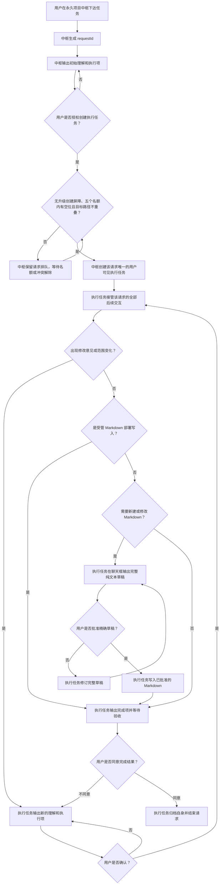

# 工作流交互模式

本文档保存 Codex Project Flow 的普通任务交互设计，作为用户与 Codex 讨论、修改交互流程时的共享依据。

流程图表达“期望怎样交互”。当前图落实后对应 `0.12.0` / schema 11；以后图发生变化时，只有用户明确要求应用，才同步更新项目规则、机器契约、运行协议、Skill 和测试。

## 共享编辑约定

- 优先直接修改下方 Mermaid 图中的节点文字、判断条件或连线。
- 尽量保留节点 ID，便于比较修改前后的流程。
- 新增步骤时使用新的唯一节点 ID；删除步骤时同时删除指向它的连线。
- 当图与其他说明冲突时，先以本图确认新的设计意图，再通过单独执行项同步实现。

## 当前交互流程

## 角色含义

- 用户：提出目标、确认初始执行项、评审范围变化与文档草稿，并验收最终结果。
- 项目中枢：只负责请求的初始理解、初始执行项、首次授权和创建唯一执行任务。
- 执行任务：任务身份建立后，负责该请求的执行、确认、文档评审、修改循环、完成验收和自归档。
- 完成项：执行任务向用户列出的实际修改、验证结果、未覆盖项和风险。

## 当前关键规则

- 中枢收到任务后先生成 `requestId`，再输出初始理解和执行项；用户首次确认前不创建执行任务。
- 每个获批请求只创建一个用户可见执行任务。真实任务 ID 或 queued `clientThreadId` 建立后，请求控制权即完成移交。
- 移交后中枢不再参与该请求的范围确认、修改、文档评审、完成验收或归档。
- 后续修改意见由原执行任务直接处理。修改导致范围变化时，原任务输出新的理解和执行项并等待用户确认。
- 用户确认后仍在原执行任务、原 `requestId` 和原 generation 中继续；修改轮次、文档评审和完成结果否决都不创建新任务。
- Bootstrap install/recovery 和 Upgrade apply/resume/rollback 写入引擎事务计划中的受管 Markdown 时无需草稿评审；普通 Markdown 和部署任务的额外非受管 Markdown 仍须先提交完整草稿和精确路径。
- 中枢最多容纳五个占位执行身份；路径不重叠的独立请求可并行，同一请求和路径重叠请求串行，满五后排队。
- 升级任务在空快照检查前先发布 provisional 创建屏障；provisional/active 期间中枢只排队新请求，既有任务仍可完成并自归档，released/cancelled 后恢复创建。
- 草稿被否决、内容变化或路径变化时，原批准失效；原任务修订完整草稿并重新提交。
- 执行任务完成后按修改、验证、未覆盖项和风险输出完成项，并在原任务中等待验收。
- 用户不同意完成结果时，原任务直接进入新的理解和执行项确认循环，不返回中枢。
- 用户最终同意后，执行任务只归档自身；归档结果明确成功并指向当前精确任务后，请求才结束。

## 后续修改方式

用户可以直接编辑本文件中的 Mermaid 图，或在对话中说明需要修改的节点和连线。Codex 读取修改后的图后，应先复述对新流程的理解，再输出需要同步到协议、配置、Skill 和测试的执行项；未经用户明确授权，不直接应用这些实现改动。
